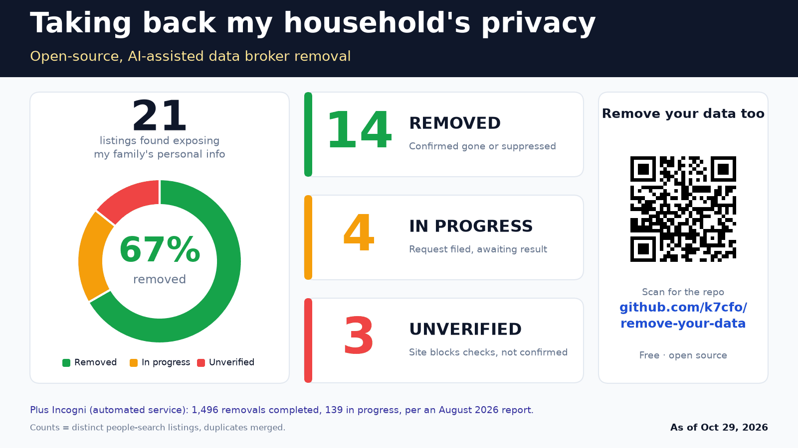
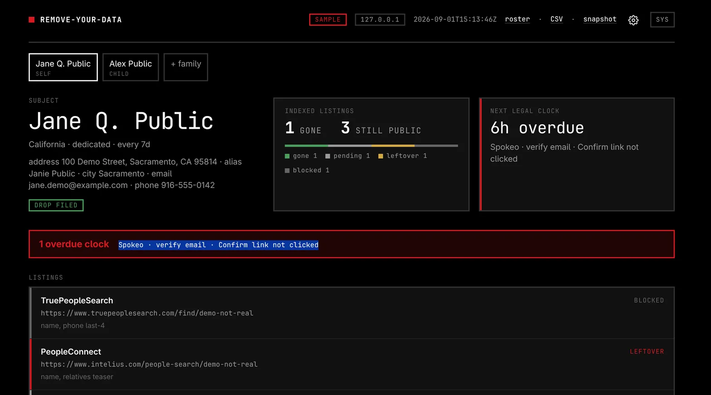

# remove-your-data

Agent skill: remove a person's listings from people-search sites and data brokers **without paying deletion services**. First-party opt-outs, CA DROP for California residents, and a local SQLite legal log. Your agent reports progress in chat; the dashboard is an optional read-only view.

This is not legal advice.



*Example: one household's results using this project (as of Oct 2026).*

## Quickstart

Paste this URL into your coding agent (Claude, Codex, Pi, OMP, Hermes, OpenClaw, Cursor, Grok, or anything that can clone a repo and read `AGENTS.md` / `SKILL.md`):

```text
https://github.com/k7cfo/remove-your-data
```

Then say: *remove my data from people-search sites.* The agent asks where you live first (California: [DROP](https://privacy.ca.gov/drop/) first), files the opt-outs, and keeps the log.

## Chat-first reporting

The agent runs `recap` at the start of every session (and after it loses context), and shows you results in chat as a status card, not a link to a dashboard:

```bash
python3 scripts/ryd.py init   --workspace "$HOME/privacy-takedown"
python3 scripts/ryd.py recap  --workspace "$HOME/privacy-takedown"
python3 scripts/ryd.py report --workspace "$HOME/privacy-takedown" --image   # PNG card
python3 scripts/ryd.py report --workspace "$HOME/privacy-takedown"           # markdown (also --text, --json)
```

Cards and recaps contain vendor names, statuses, counts, and relative due dates only: no addresses, phones, emails, URLs, or request ids. The PNG renderer needs no dependencies (Pillow is used automatically if installed; `RYD_NO_PIL=1` forces the built-in renderer).

## If you are an agent

This repo **is** the skill.

1. Read [`AGENTS.md`](AGENTS.md) (boot), then [`SKILL.md`](SKILL.md) (playbook).
2. Run `ryd.py recap` first, every session. Then §0 (tools this host has) and §1 intake, one question at a time.
3. Keep the workspace (`takedown.db` or paper log, evidence) **outside** this clone. Data flow: [`docs/PRIVACY.md`](docs/PRIVACY.md). No Python is fine: coach or paper log (`SKILL.md` §0).

## Optional: read-only dashboard

`ryd.py serve --workspace "$HOME/privacy-takedown"` starts a localhost-only (`127.0.0.1:8765`) view of the log. The running report and offline [Privacy landscape](docs/PRIVACY.md#privacy-landscape) are read-only; the roster and settings pages are optional forms for editing the household and scan routine (agents can use the CLI instead). It is not required; the chat report above is the primary interface. Synthetic sample data in the shots:



Optional, off by default: multi-engine leftover watch via SerpApi (`SERPAPI_API_KEY` + `ryd.py serp-check --serpapi`). Watch-only; see [`references/search.md`](references/search.md). No key? Sign up free (250 searches/mo, email + phone verify) at https://serpapi.com/users/sign_up, copy the key from https://serpapi.com/manage-api-key, and set `SERPAPI_API_KEY`. SerpApi's official MCP ([serpapi-mcp](https://github.com/serpapi/serpapi-mcp), `https://mcp.serpapi.com/mcp` with a Bearer key) also works. SearchAPI.io is a different service; its keys will not work here.

## Contributing & forks

Forks are welcome. The best place to send fixes (dead opt-out URLs, new official forms, DROP/GDPR clock corrections, captcha and mailbox gotchas, notes for a specific agent host) is a pull request here, so everyone gets them. If you publish your own version, please keep the `NOTICE` and `LICENSE` files and say it is based on [remove-your-data by Nick Newsom (@k7cfo)](https://github.com/k7cfo/remove-your-data).

See [`CONTRIBUTING.md`](CONTRIBUTING.md).

## Why

Data brokers publish you. Paid “we'll delete you” apps mostly file the same free forms, then charge rent because brokers re-scrape. Some of those brands sit next to the people-search business. This skill is the mop you run yourself.

## License & credit

[Apache-2.0](LICENSE). Free to use, modify, and redistribute, including commercially. Please keep the [`NOTICE`](NOTICE) file with any copy or derivative, and cite the project if you use it in writing; GitHub's **Cite this repository** button reads [`CITATION.cff`](CITATION.cff).

Original author: Nick Newsom (@k7cfo). Contributions are accepted under the same license (Apache-2.0 section 5).

What changed: [`CHANGELOG.md`](CHANGELOG.md).

## Development

QA is Python-stdlib-only and uses temporary synthetic identities. It never contacts a broker or submits a live form.

```bash
python3 -m compileall -q scripts tests
python3 -m unittest discover -s tests -v
RYD_NO_PIL=1 python3 -m unittest discover -s tests   # built-in PNG renderer only
```

GitHub Actions (`.github/workflows/qa.yml`) runs the test suite on Python 3.10–3.13. Real-data dashboards remain loopback-only; `RYD_PREVIEW=1` can expose only the built-in synthetic `--demo` workspace.
