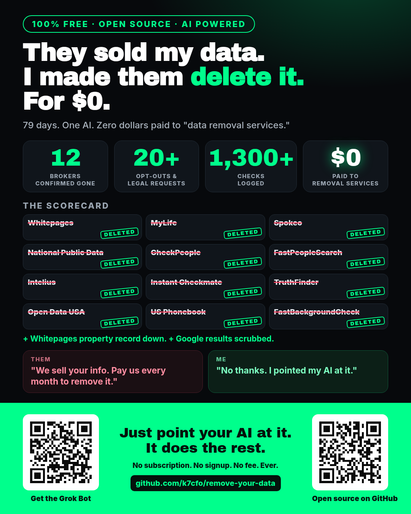
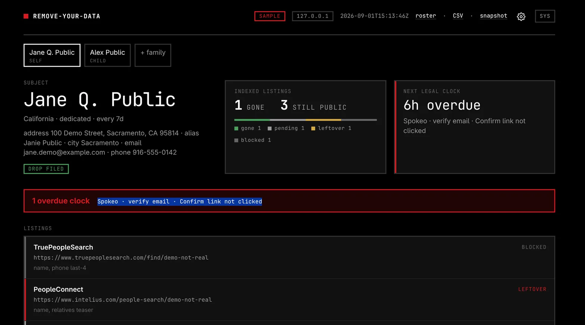

# remove-your-data

**Delete yourself from data brokers for $0. Just point your AI at it.**

[](LICENSE)
[](https://github.com/k7cfo/remove-your-data/actions/workflows/qa.yml)
[](https://github.com/k7cfo/remove-your-data/stargazers)


Original repo: https://github.com/k7cfo/remove-your-data by Nick Newsom (@k7cfo). If you are reading a copy or a fork, the original is the place for fixes and updates.

<p align="center">
  <a href="https://k7cfo.github.io/remove-your-data/watch.html"></a>
  <br>
  <sub><a href="https://k7cfo.github.io/remove-your-data/watch.html">Watch the 30 second explainer (with sound)</a></sub>
</p>

An agent skill that removes a person's listings from people-search sites and data brokers without paying a deletion service. It files first-party opt-outs, routes California residents through DROP, keeps a local SQLite log of every request, and reports progress in chat. This is not legal advice.

<p align="center">
  
</p>

*My actual results (as of Nov 2026). The story behind this: [thread on X](https://x.com/Ask_Nick/status/2121282617408700478).*

## Quick start

**Grok Bot (easiest):** [**Get the Remove My Data bot**](https://x.ai/bot/zDwvcgFqUS8825GmUGg7F). One click and it's ready. It walks you through everything.

**Any other AI agent:** paste this link into Claude Code, Codex, Cursor, Hermes, OpenClaw, or any agent that can read a repo, then say *remove my data from people-search sites.*

```text
https://github.com/k7cfo/remove-your-data
```

The agent asks where you live first (California residents start with [DROP](https://privacy.ca.gov/drop/)), files the opt-outs, and keeps the log.

## What the agent does for you

- Files from your own email, so verification links and codes land in an inbox you can open.
- Answers verification links, codes, and broker replies for you, and logs each one.
- Tracks legal deadlines (state privacy-law clocks count from the date a company received the request).
- Escalates stale requests with follow-up emails. On a host that can place calls, such as Grok Bot, you can also tell it to phone a company.
- Shows a results card in chat after every pass, so you never have to open a dashboard.
- Covers the whole household: a spouse, partner, parent, or kid is added with their own email and filed as that person.

## How it compares

How remove-your-data compares with paid removal services. Prices checked Nov 14, 2026 for one US adult. Paid services are real products with real strengths: they are hands-off, they have human support, and they run large automated broker lists. This project trades that for cost, control, and transparency.

Legend: ✅ yes, ◐ partial, ❌ no, ? not stated by the vendor.

| | remove-your-data | [DeleteMe](https://joindeleteme.com/pricing/) | [Incogni](https://incogni.com/pricing) | [Optery](https://www.optery.com/pricing/) | [Kanary](https://www.kanary.com/pricing-individual) | [Aura](https://www.aura.com/pricing)¹ | [Privacy Bee](https://privacybee.com/pricing/) | [EasyOptOuts](https://easyoptouts.com/pricing) |
|---|---|---|---|---|---|---|---|---|
| Cheapest annual plan | **$0** | $129 | $95.88 | $39 | $250 | $144 | about $8/mo, billed yearly² | $19.99 |
| Per month, billed annually | **$0** | $10.75 | $7.99 | $3.25 | $20.83 | $12 | about $8 | $1.67 |
| Monthly plan | n/a | no³ | $15.98 | $3.99 | $25 | $15 | not shown | none listed |
| Open source, you can read every request it sends | ✅ | ❌⁴ | ❌ | ❌ | ❌ | ❌ | ❌ | ❌ |
| Your data stays on your own machine (local SQLite log) | ✅⁵ | ❌ | ❌ | ❌ | ❌ | ❌ | ❌ | ❌ |
| Files from your own email and handles the back-and-forth | ✅ | ❌⁶ | ❌⁶ | ❌⁶ | ?⁶ | ❌⁶ | ❌⁶ | ◐⁶ |
| State privacy-law requests with tracked legal deadlines | ✅ | ? | ◐⁷ | ◐⁷ | ◐⁷ | ? | ◐⁷ | ? |
| California DROP | ◐⁸ | ❌ | ? | ❌ | ? | ? | ? | ? |
| Household or family members | ✅ free | ◐⁹ | ◐⁹ | ◐⁹ | ◐⁹ | ◐⁹ | ◐⁹ | ❌ |
| Follow-up on stale requests | ✅ | ✅ | ✅ | ◐ | ✅ | ✅ | ✅ | ? |
| Phone-call escalation | ✅ on hosts that can call¹⁰ | ? | ? | ? | ? | ? | ? | ? |
| Custom removal for any site you name | ✅ | ◐¹¹ | ◐¹¹ | ◐¹¹ | ◐¹¹ | ? | ◐¹¹ | ❌ |
| Multi-engine leftover scan | ◐¹² | ? | ? | ✅ | ✅ | ◐ | ? | ◐ |
| Recurring re-scans | ◐¹³ | ✅ | ✅ | ✅ | ✅ | ✅ | ✅ | ✅ |
| Works inside the AI you already use (Grok Bot, Claude, Codex, Cursor) | ✅ | ❌ | ❌ | ❌ | ❌ | ❌ | ❌ | ❌ |
| Brokers covered (advertised) | any site the agent can reach¹⁴ | not stated | 420+ | 375+ to 620+ | highest-traffic sites | 425+ | 597 (people search) | 200+ |
| Hands-off, with human support | ❌ | ✅ | ✅ | ✅¹⁵ | ✅ | ✅ | ✅ | ? |

Where paid services win: you do nothing after signup, a person answers when something breaks, and the broker lists are large and maintained for you. Where this project differs: it is free, you can read the code and every request, the log stays on your machine, and it can work through the replies using your own inbox.

**Notes**

1. Aura sells data removal inside an identity-protection bundle (credit monitoring, antivirus, VPN), not on its own. The $144 first-year price is for the Individual plan; renewal is reported to be higher.
2. Privacy Bee shows "$8/month, approx when billed annually" for Essentials and does not show an annual total.
3. DeleteMe bills one or two years up front. The $129 plan is on its [help page](https://help.joindeleteme.com/hc/en-us/articles/26605377008531-How-much-does-a-DeleteMe-Subscription-cost); the no-monthly detail comes from third-party reviews.
4. As far as we could find, none of these services publish their source. We did not audit each one.
5. The agent host and the AI model you use will see what you tell the agent. The SQLite log and evidence files stay on your disk.
6. Per their own terms and help pages, DeleteMe, Incogni, Optery, Aura, and Privacy Bee act as your authorized agent and use their own or a proxy mailbox (Optery says it always uses disposable addresses and never your email). Brokers can still email you to confirm. Kanary does not say whose mailbox it uses. EasyOptOuts puts your contact email on its requests, is fully automated, and does not say how it handles replies.
7. These services send state-law or regulator-backed requests as your agent (Optery lists 16 states; Kanary lists regulator and attorney general escalation). None of them says it shows you statutory deadline clocks.
8. The agent walks you through DROP and logs it. You complete the California identity check yourself. DeleteMe and Optery describe DROP as something to use alongside their service.
9. Paid family or multi-person plans cost extra. Examples: DeleteMe 2 people $229/yr, Incogni Family $191.88/yr, Kanary 50% off each added family member.
10. This depends on the host. The repo itself places no calls; a host such as Grok Bot can, if you tell it to.
11. Custom removals usually need a higher tier or have a yearly limit (Incogni Unlimited, Optery Ultimate, Kanary Advanced, Privacy Bee Pro, DeleteMe's yearly custom allowance).
12. Optional and watch-only. Needs a free SerpApi key. See the next section.
13. Re-scans run when you run the agent, or on a schedule if your host has a scheduler.
14. This project does not keep a fixed broker count. It covers what the agent can find and file, plus the broker playbook in [`references/brokers.md`](references/brokers.md). Advertised counts from paid services are not directly comparable to that.
15. Optery's lowest paid plan is fully automated with no human agent; human agents start on its higher plans.

Price sources, all checked Nov 14, 2026: [DeleteMe](https://help.joindeleteme.com/hc/en-us/articles/26605377008531-How-much-does-a-DeleteMe-Subscription-cost), [Incogni](https://incogni.com/pricing), [Optery](https://www.optery.com/pricing/), [Kanary](https://www.kanary.com/blog/2026-product-brief), [Aura](https://www.aura.com/pricing), [Privacy Bee](https://privacybee.com/pricing/), [EasyOptOuts](https://easyoptouts.com/pricing). Prices and plans change; check the vendor before you buy. For independent results on paid services, see [Consumer Reports' 2024 study](https://www.consumerreports.org/electronics/personal-information/services-that-delete-data-from-people-search-sites-review-a2705843415/).

If this saved you a subscription, a star helps others find it.

## Leftover scan across search engines (free)

After the opt-outs go through, the agent can check whether listings still show up in search results. That is the optional SerpApi step.

**What it is.** [SerpApi](https://serpapi.com) is a search-results API. Its free plan gives 250 searches a month (checked on [serpapi.com/pricing](https://serpapi.com/pricing), Nov 14, 2026).

**What it does.** `ryd.py serp-check` searches for each person's name, name plus city or street, and phone numbers. It uses Google and Bing by default, and can also use Yahoo, DuckDuckGo, Yandex, Baidu, and Naver (`--engines google,bing,yahoo,duckduckgo`). Each hit prints as one JSON line with the engine, query, URL, title, and snippet. Hits on hosts you told it to keep are dropped.

**Optional and watch-only.** It is off unless a key is set and you pass `--serpapi`. It never files anything; removing a stale search result stays the last step, after the original page is gone. Names are sent to SerpApi, so if a person's anonymity mode is set to max it refuses unless that person says yes.

**Get a key.**

1. Sign up free at https://serpapi.com/users/sign_up (email and phone verification).
2. Copy your key from https://serpapi.com/manage-api-key.
3. Set it as the `SERPAPI_API_KEY` environment variable in your secret store or `.env`. Do not paste it into chat or commit it. Keys from SearchAPI.io are a different service and will not work.

```bash
SERPAPI_API_KEY=... python3 scripts/ryd.py serp-check --workspace "$HOME/privacy-takedown" --serpapi --engines google,bing,duckduckgo
```

SerpApi's official MCP server ([serpapi-mcp](https://github.com/serpapi/serpapi-mcp), `https://mcp.serpapi.com/mcp` with a Bearer key) also works.

**How it stays inside the free tier.**

- Each query on each engine costs one search. Queries are deduplicated, and there is no `site:` fan-out.
- A hard monthly cap, 100 searches by default (`RYD_SERPAPI_MONTHLY_CAP`), is counted in `serpapi-usage.json` inside your workspace and resets each UTC month. At the cap the scan stops with a clear message.
- Before running, it asks SerpApi's free account endpoint how many searches are left, which does not use a search, and uses whichever number is lower.
- Example: one person with a name, a city, and two phone numbers is about 6 queries. On 2 engines, run weekly, that is about 48 searches a month. Two people is about 96. Adding engines or people means running it less often or raising the cap on purpose.

Details for agents: [`references/search.md`](references/search.md).

## Chat-first reporting

The agent runs `recap` at the start of every session (and after it loses context), and shows you results in chat as a status card, not a link to a dashboard:

```bash
python3 scripts/ryd.py init   --workspace "$HOME/privacy-takedown"
python3 scripts/ryd.py recap  --workspace "$HOME/privacy-takedown"
python3 scripts/ryd.py report --workspace "$HOME/privacy-takedown" --image   # PNG card
python3 scripts/ryd.py report --workspace "$HOME/privacy-takedown"           # markdown (also --text, --json)
```

Cards and recaps contain vendor names, statuses, counts, and relative due dates only: no addresses, phones, emails, URLs, or request ids. The PNG renderer needs no dependencies (Pillow is used automatically if installed; `RYD_NO_PIL=1` forces the built-in renderer).

## Privacy and data flow

This skill files the person's own opt-outs and has no telemetry. What leaves your machine is what an official form, letter, or regulator already needs, plus the mailbox you let the agent read. The workspace (log, evidence, exports) lives outside the git clone. Full details: [`docs/PRIVACY.md`](docs/PRIVACY.md).

## If you are an agent

This repo **is** the skill.

1. Read [`AGENTS.md`](AGENTS.md) (boot), then [`SKILL.md`](SKILL.md) (playbook).
2. Run `ryd.py recap` first, every session. Then §0 (tools this host has) and §1 intake, one question at a time.
3. Keep the workspace (`takedown.db` or paper log, evidence) **outside** this clone. No Python is fine: coach or paper log (`SKILL.md` §0).

## Optional: read-only dashboard

`ryd.py serve --workspace "$HOME/privacy-takedown"` starts a localhost-only (`127.0.0.1:8765`) view of the log. The running report and offline [Privacy landscape](docs/PRIVACY.md#privacy-landscape) are read-only; the roster and settings pages are optional forms for editing the household and scan routine (agents can use the CLI instead). It is not required; the chat report above is the primary interface. Synthetic sample data in the shots:



## Contributing and forks

Forks are welcome. The best place to send fixes (dead opt-out URLs, new official forms, DROP and state-law clock corrections, captcha and mailbox gotchas, notes for a specific agent host) is a pull request here, so everyone gets them. New here? Pick a checkbox from the [good first issues in #21](https://github.com/k7cfo/remove-your-data/issues/21).

If you publish your own version, please keep the `NOTICE` and `LICENSE` files and say it is based on [remove-your-data by Nick Newsom (@k7cfo)](https://github.com/k7cfo/remove-your-data).

See [`CONTRIBUTING.md`](CONTRIBUTING.md).

## Why

Data brokers publish you, and listings come back, so removal is a repeat job. This skill is the one you run yourself, with a log of every request.

## License & credit

[Apache-2.0](LICENSE). Free to use, modify, and redistribute, including commercially. Please keep the [`NOTICE`](NOTICE) file with any copy or derivative, and cite the project if you use it in writing; GitHub's **Cite this repository** button reads [`CITATION.cff`](CITATION.cff).

Original author: Nick Newsom (@k7cfo). Contributions are accepted under the same license (Apache-2.0 section 5).

What changed: [`CHANGELOG.md`](CHANGELOG.md).

## Development

QA is Python-stdlib-only and uses temporary synthetic identities. It never contacts a broker or submits a live form.

```bash
python3 -m compileall -q scripts tests
python3 -m unittest discover -s tests -v
RYD_NO_PIL=1 python3 -m unittest discover -s tests   # built-in PNG renderer only
```

GitHub Actions (`.github/workflows/qa.yml`) runs the test suite on Python 3.10–3.13. Real-data dashboards remain loopback-only; `RYD_PREVIEW=1` can expose only the built-in synthetic `--demo` workspace.
